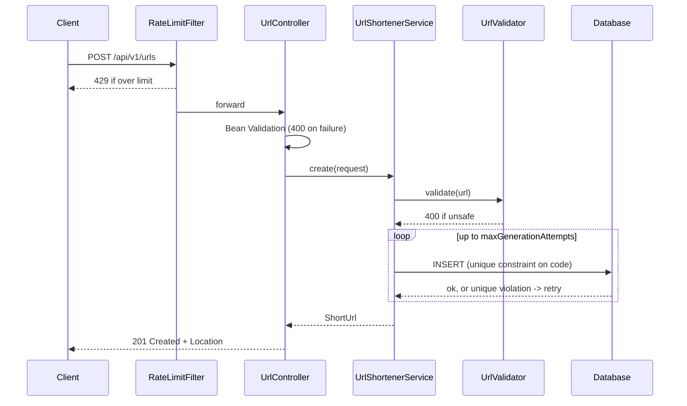
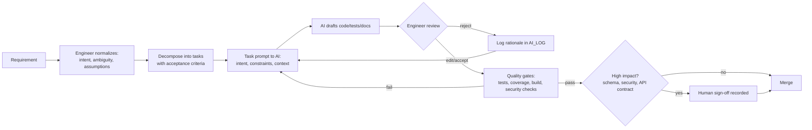

# Architecture Overview

## Components

| Layer | Component | Responsibility |
|---|---|---|
| Web | `UrlController` | Create links, read stats (`/api/v1/urls`) |
| Web | `RedirectController` | Resolve code, enforce expiry, trigger analytics, return 302 |
| Web | `RateLimitFilter` | Per-IP limit on link creation (429) |
| Web | `GlobalExceptionHandler` | Domain errors to RFC 7807 `ProblemDetail`, no internals leaked |
| Service | `UrlShortenerService` | Creation, collision retry, alias rules, cached resolution, stats |
| Service | `UrlValidator` | Destination safety: scheme allowlist, host, loop prevention, blocklist |
| Service | `CodeGenerator` | `SecureRandom` Base62 codes |
| Service | `AnalyticsService` | Asynchronous click recording |
| Service | `FixedWindowRateLimiter` | In-memory per-client counters with scheduled eviction |
| Data | JPA repositories + Flyway | Schema owned by versioned migrations |
| Infra | Caffeine, Actuator, springdoc | Redirect cache, health/metrics, OpenAPI |

Tools: Java 21, Spring Boot 3.3, PostgreSQL (H2 for zero-setup dev/tests), Flyway, Caffeine, JUnit 5, Mockito, AssertJ, Awaitility, JaCoCo, Docker, GitHub Actions.

## Control flow

### Create



### Redirect (hot path)

```mermaid
sequenceDiagram
    participant C as Client
    participant RC as RedirectController
    participant S as UrlShortenerService
    participant Cache as Caffeine
    participant DB as Database
    participant A as AnalyticsService (async)
    C->>RC: GET /{code}
    RC->>S: resolve(code)
    S->>Cache: lookup
    alt miss
        S->>DB: SELECT by code
        S->>Cache: store RedirectTarget
    end
    RC->>RC: expiry check (410 Gone)
    RC-)A: recordClick (fire and forget)
    RC-->>C: 302 Location, Cache-Control: no-store
    A->>DB: UPDATE click_count = click_count + 1; INSERT click_event
```

## Data model

```
short_url                         click_event
---------                         -----------
id            BIGINT PK           id            BIGINT PK
code          VARCHAR(32) UNIQUE  short_url_id  BIGINT FK -> short_url (cascade)
original_url  VARCHAR(2048)       clicked_at    TIMESTAMPTZ
created_at    TIMESTAMPTZ         referrer      VARCHAR(512)
expires_at    TIMESTAMPTZ NULL    user_agent    VARCHAR(512)
click_count   BIGINT (V2)         INDEX (short_url_id, clicked_at)
```

## Key decisions

| Decision | Choice | Rationale | Alternative rejected |
|---|---|---|---|
| Code generation | Random Base62, 7 chars | Not enumerable; ~3.5T keyspace | Sequential ID encoding: leaks volume, guessable |
| Uniqueness | DB unique constraint + retry | Correct under concurrency | `exists` check then insert: race condition |
| Create transaction | Not wrapped in one transaction | PostgreSQL aborts a transaction after a constraint error, which would break retry | `@Transactional` on `create` |
| Redirect status | 302 + `no-store` | Keeps analytics and expiry enforceable | 301: cached forever by browsers |
| Analytics | Async, bounded queue, best effort | Redirect latency unaffected; queue saturation never fails a redirect | Synchronous insert on redirect path |
| Click counter | Atomic SQL `UPDATE ... + 1` | No lost updates | Read-modify-write in JPA entity |
| Cache | Caffeine, 10 min TTL, expiry re-checked per request | Mappings are immutable; expired links never served | Cache without expiry check |
| Schema | Flyway, `ddl-auto: none` | Reviewable, versioned, additive migrations | Hibernate auto-DDL |
| Rate limiting | In-memory fixed window | Simple and sufficient for a single instance | Redis/Bucket4j: needed only for multi-instance (documented) |
| Errors | RFC 7807 ProblemDetail | Consistent contract, no stack traces | Ad hoc error bodies |

## Execution approach (engineer-led, AI-assisted)



AI works inside a task; the engineer owns the task definition, the accept/reject decision, and production readiness.
